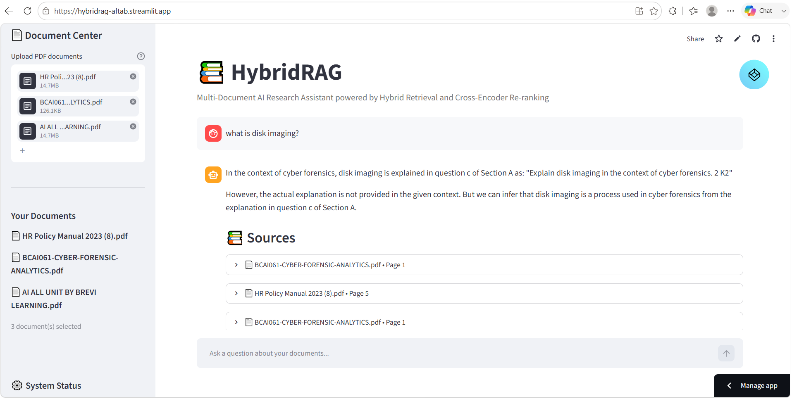

# 📚 HybridRAG — Multi-Document AI Research Assistant

> An AI-powered document question-answering system using Hybrid RAG, combining BM25 keyword retrieval, FAISS semantic search, Cross-Encoder re-ranking, and Groq LLMs.

## 🚀 Live Demo

🔗 **Live Application:** [HybridRAG Demo](https://hybridrag-aftab.streamlit.app/)

🔗 **GitHub:** https://github.com/Aftab45-hub/HybridRAG-AI-Research-Assistant

## 🖥️ Application Preview



## ✨ Features

* 📄 Upload multiple PDF documents
* 🔎 Hybrid retrieval using BM25 + FAISS
* 🧠 Semantic search using HuggingFace embeddings
* 🎯 Cross-Encoder re-ranking
* 🤖 LLM-powered question answering using Groq
* 📚 Source document and page references
* 📊 Retrieval latency comparison
* 📈 BM25 vs Dense vs Hybrid vs Hybrid + Reranker analytics
* 💬 Interactive Streamlit interface
* ⚡ Multi-document question answering

## 🧠 Architecture

```text
PDF Documents
      ↓
PDF Text Extraction
      ↓
Text Chunking
      ↓
HuggingFace Embeddings
      ↓
 ┌───────────────┐
 │               │
FAISS           BM25
 │               │
 └───────┬───────┘
         ↓
  Hybrid Retrieval
         ↓
 Cross-Encoder
   Re-ranking
         ↓
   Top Context
         ↓
     Groq LLM
         ↓
    Final Answer
         ↓
      Sources
```

## 🔍 How It Works

### 1. PDF Processing

Users can upload multiple PDF documents. The application extracts their content using `PyPDFLoader`.

### 2. Chunking

The extracted text is divided into smaller overlapping chunks using `RecursiveCharacterTextSplitter`.

Current configuration:

* Chunk size: 1000
* Chunk overlap: 200

### 3. Dense Retrieval

The system generates semantic embeddings using:

`sentence-transformers/all-MiniLM-L6-v2`

These embeddings are stored in a FAISS vector database.

### 4. Sparse Retrieval

BM25 performs keyword-based retrieval from the document chunks.

### 5. Hybrid Retrieval

BM25 and FAISS retrieval are combined using `EnsembleRetriever`.

Current weights:

* BM25: 40%
* FAISS: 60%

### 6. Re-ranking

Retrieved documents are passed through a Cross-Encoder:

`cross-encoder/ms-marco-MiniLM-L-6-v2`

The documents are scored according to their relevance to the user's question.

### 7. LLM Answer Generation

The highest-ranked context is passed to the Groq-hosted Llama model to generate a grounded answer.

### 8. Sources

The application displays the source document and page information associated with the retrieved context.

## 📊 Retrieval Analytics

The application compares:

| Method            | Description                                           |
| ----------------- | ----------------------------------------------------- |
| BM25              | Keyword-based retrieval                               |
| Dense / FAISS     | Semantic retrieval                                    |
| Hybrid            | BM25 + FAISS                                          |
| Hybrid + Reranker | Hybrid retrieval followed by Cross-Encoder re-ranking |

The application also displays retrieval latency through a comparison chart.

## 🛠️ Tech Stack

**Languages**

* Python

**AI / ML**

* Retrieval-Augmented Generation
* Sentence Transformers
* Cross-Encoder
* FAISS
* BM25
* Large Language Models

**Frameworks**

* LangChain
* Streamlit

**LLM**

* Groq
* Llama

**Document Processing**

* PyPDF

## 📁 Project Structure

```text
HybridRAG-AI-Research-Assistant/
│
├── app.py
├── main.py
├── requirements.txt
├── pyproject.toml
├── uv.lock
├── .python-version
├── .env.example
├── .gitignore
├── README.md
│
└── screenshots/
    └── screenshotshybridrag-demo.png
```

## ⚙️ Run Locally

### Clone the repository

```bash
git clone https://github.com/Aftab45-hub/HybridRAG-AI-Research-Assistant.git
cd HybridRAG-AI-Research-Assistant
```

### Install dependencies

```bash
uv pip install -r requirements.txt
```

### Configure environment variables

Create a `.env` file:

```text
GROQ_API_KEY=your_groq_api_key
```

### Run

```bash
uv run streamlit run app.py
```

## 🔐 Environment Variables

Create a `.env` file containing:

```text
GROQ_API_KEY=your_groq_api_key
```

Never upload `.env` to GitHub.

Use `.env.example` as a template.

## 🎯 Why Hybrid RAG?

Traditional keyword retrieval is useful for exact terms, while semantic retrieval is better at understanding meaning.

Hybrid RAG combines both:

```text
BM25
Keyword Search
      +
FAISS
Semantic Search
      ↓
Hybrid Retrieval
      ↓
Cross-Encoder Re-ranking
      ↓
Relevant Context
      ↓
LLM
      ↓
Grounded Answer
```

## 🎓 Key Concepts Demonstrated

* Retrieval-Augmented Generation
* Semantic Search
* Keyword Search
* Vector Search
* Embeddings
* Hybrid Retrieval
* Re-ranking
* Prompt Engineering
* LLM Integration
* Document Question Answering
* Streamlit Application Development

## 👨‍💻 Author

**Aftab Alam**

B.Tech — Computer Science & Artificial Intelligence / Machine Learning

GitHub:
https://github.com/Aftab45-hub
